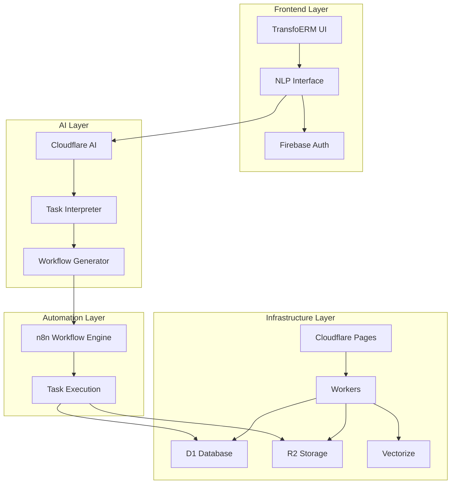

# TransfoERM: Transforming Enterprise Software with AI-Powered Automation and Customization

## 🎯 Vision

TransfoERM transforms enterprise software by leveraging *AI-powered automation* and *natural language processing (NLP)* to simplify business processes. Unlike traditional ERP systems that require manual coding and third-party consultants, TransfoERM empowers businesses with instant, AI-generated solutions tailored to their needs in real-time.

### Why TransfoERM?

Traditional ERP systems are rigid, expensive, and require extensive customization. TransfoERM disrupts this model by offering:

- *Zero-code automation* through natural language commands
- *AI-generated integrations and workflows*
- *Dynamic ERP solutions that evolve with your business*
- *Significant cost reduction* by eliminating the need for custom development

---

## Key Features

1. **Task Creation & Execution (NLP Command Center)**

   - Natural language input (text/voice) for instant task creation
   - AI-powered command interpretation and workflow generation
   - Intelligent execution confirmation and monitoring
   - Real-time status updates and notifications

2. **Intelligent Customization & Automation**

   - Dynamic company-specific customizations through AI
   - Zero-code workflow creation and modification
   - Continuous learning and adaptation to business needs
   - Automated code generation for complex integrations

3. **Smart Integration & Management**

   - AI-generated integrations with existing systems
   - Automated maintenance and updates
   - Self-healing workflows and error recovery
   - Intelligent resource optimization

---

## System Architecture



## Tech Stack

### Frontend Technologies

- **Framework**: Next.js 14+ on Cloudflare Pages
- **Authentication**: Firebase Auth
- **State Management**: Zustand
- **UI Components**: Tailwind CSS + Radix UI

### AI & Automation

- **Language Model**: Cloudflare AI (LLaMA-2)
- **Vector Store**: Cloudflare Vectorize
- **Workflow Engine**: n8n
- **Task Processing**: Custom NLP pipeline

### Infrastructure

- **Compute**: Cloudflare Workers
- **Database**: Cloudflare D1
- **Storage**: Cloudflare R2
- **Caching**: Cloudflare KV

---

## Getting Started

### Prerequisites

```bash
- Node.js 18+
- Docker & Docker Compose
- Wrangler CLI
- Firebase project
```

### Environment Variables

```bash
# Cloudflare
CLOUDFLARE_AI_TOKEN=
CLOUDFLARE_ACCOUNT_ID=

# Firebase
FIREBASE_API_KEY=
FIREBASE_AUTH_DOMAIN=
FIREBASE_PROJECT_ID=

# n8n
N8N_WEBHOOK_URL=
N8N_API_KEY=
```

### Installation

```bash
git clone https://github.com/codeiwthmirza/transfoerm.git
cd transfoerm
npm install
cp .env.example .env.local
```

### Development

```bash
# Start development server
npm run dev

# Deploy n8n
docker-compose up -d n8n
```

